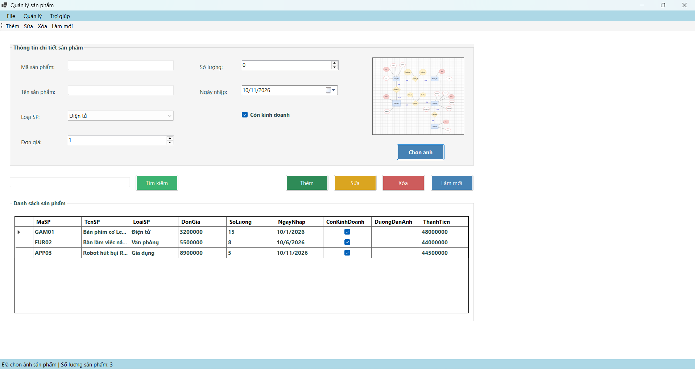
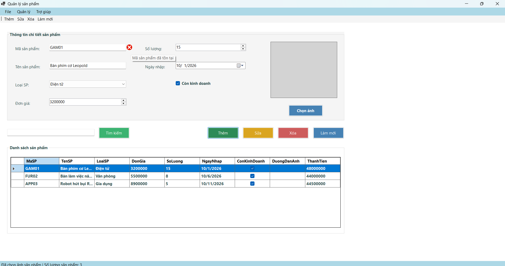
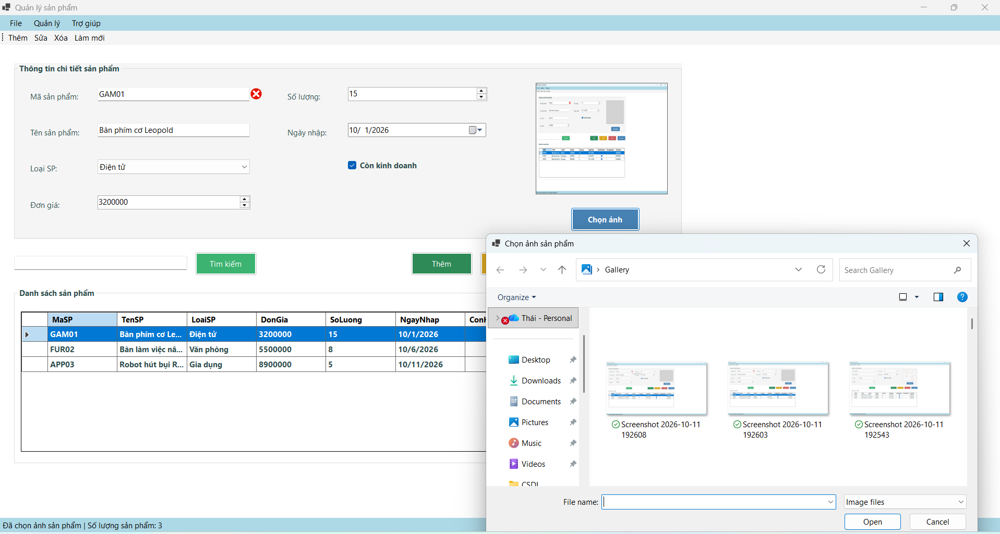
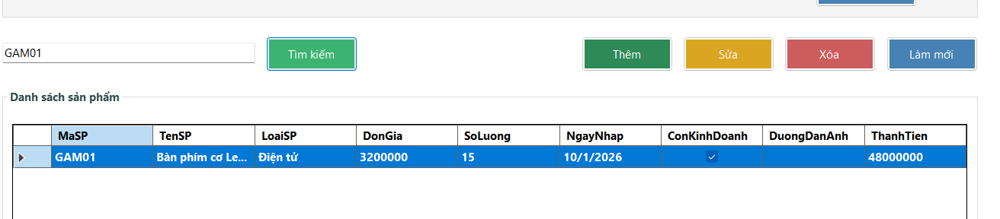
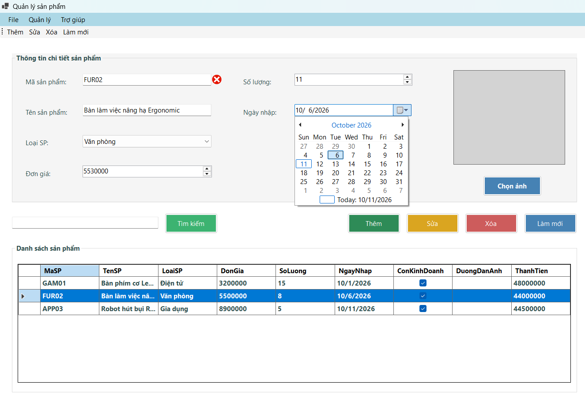
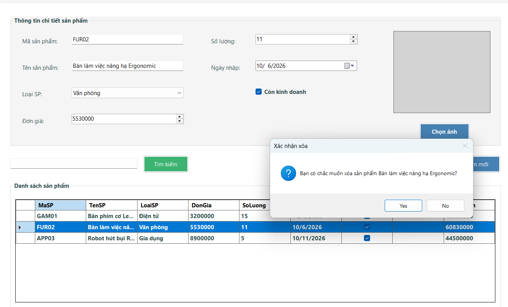

# Lab 06 - Quản lý sản phẩm (Windows Forms Nâng cao và DataGridView)

## Thông tin sinh viên
* **Họ tên:** 
* **MSSV:** 
* **Lớp:** 

## Mô tả dự án
ProductManager là ứng dụng Windows Forms quản lý danh sách sản phẩm của cửa hàng. Dự án này tập trung vào việc áp dụng các kiến thức nâng cao trong thiết kế giao diện và xử lý dữ liệu bộ nhớ (BindingList, BindingSource) kết hợp với DataGridView. Ứng dụng cũng tích hợp các công cụ điều hướng chuyên nghiệp như MenuStrip, ToolStrip, StatusStrip và ContextMenuStrip để tăng tính trực quan và tiện dụng cho người dùng.

## Các control và kỹ thuật áp dụng
* **DataGridView & BindingSource:** Quản lý và hiển thị danh sách sản phẩm động, tự động đồng bộ khi có thay đổi dữ liệu.
* **ErrorProvider:** Kiểm tra tính hợp lệ của dữ liệu đầu vào (Validation) trực tiếp trên form một cách trực quan.
* **OpenFileDialog & PictureBox:** Hỗ trợ duyệt thư mục, chọn và hiển thị hình ảnh minh họa cho từng sản phẩm.
* **MenuStrip & ToolStrip:** Hệ thống thanh menu và thanh công cụ thao tác nhanh, dễ dàng điều hướng.
* **StatusStrip:** Thanh trạng thái dưới cùng để cập nhật liên tục các thao tác vừa thực hiện và đếm tổng số lượng sản phẩm.
* **ContextMenuStrip:** Trình đơn chuột phải hỗ trợ thao tác nhanh (Sửa, Xóa, Xem chi tiết) trực tiếp trên các dòng dữ liệu.

## Chức năng chi tiết
1. **Tải dữ liệu mẫu:** Tự động nạp danh sách loại sản phẩm và hiển thị một số sản phẩm mặc định ngay khi khởi động ứng dụng.
2. **Thêm sản phẩm:** Ghi nhận đầy đủ thông tin (Mã, Tên, Loại, Đơn giá, Số lượng, Ngày nhập, Tình trạng, Hình ảnh). 
3. **Kiểm tra dữ liệu (Validation):** Bắt lỗi chặt chẽ (mã không được rỗng, mã không trùng lặp, tên không rỗng, đơn giá lớn hơn 0, ngày nhập không được lớn hơn ngày hiện tại).
4. **Sửa sản phẩm:** Chọn sản phẩm từ DataGridView để đưa thông tin lên các ô nhập liệu, thực hiện chỉnh sửa và cập nhật lại danh sách.
5. **Xóa sản phẩm:** Yêu cầu xác nhận qua hộp thoại (MessageBox) trước khi xóa dòng dữ liệu đang chọn.
6. **Tìm kiếm:** Lọc nhanh danh sách dữ liệu theo mã sản phẩm hoặc tên sản phẩm (không phân biệt chữ hoa/thường).
7. **Quản lý hình ảnh:** Mở hộp thoại chọn ảnh tiêu chuẩn của Windows để tải hình ảnh lên giao diện.
8. **Làm mới dữ liệu:** Xóa trắng thông tin đang nhập, gỡ bỏ toàn bộ cảnh báo lỗi và nạp lại danh sách gốc.
9. **Xem chi tiết:** Tính toán cột Thành tiền (Đơn giá x Số lượng) và hiển thị bảng tóm tắt chi tiết qua tùy chọn của menu chuột phải.

## Hình ảnh minh họa

### 1. Giao diện tổng quan và danh sách sản phẩm

### 2. Kiểm tra dữ liệu hợp lệ bằng ErrorProvider

### 3. Chức năng duyệt và thêm hình ảnh sản phẩm (OpenFileDialog)

### 4. Tìm kiếm sản phẩm theo từ khóa

### 5. Tùy chọn thao tác trên thanh ToolStrip và MenuStrip

### 6. Hộp thoại xác nhận an toàn trước khi xóa

