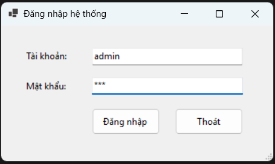
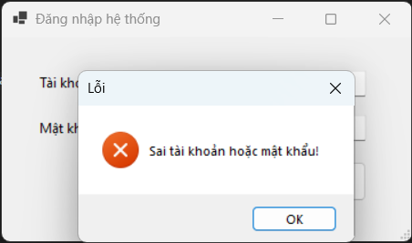
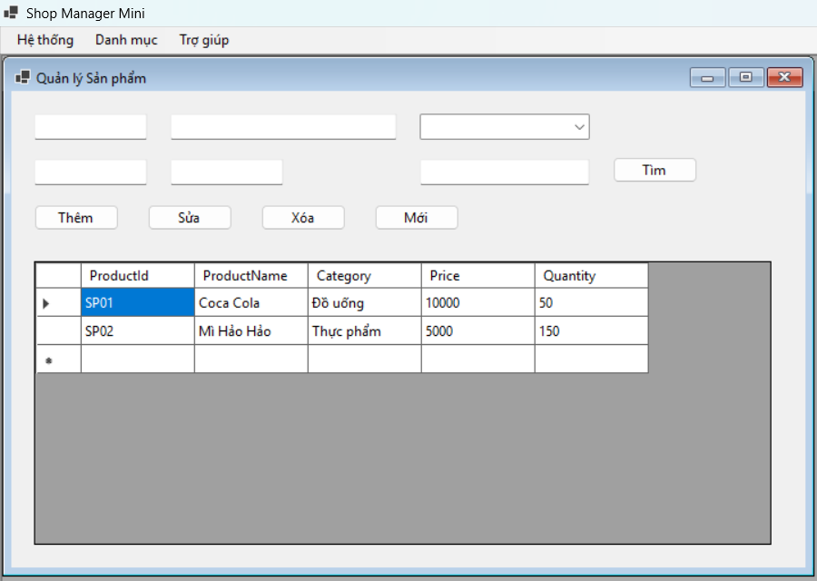
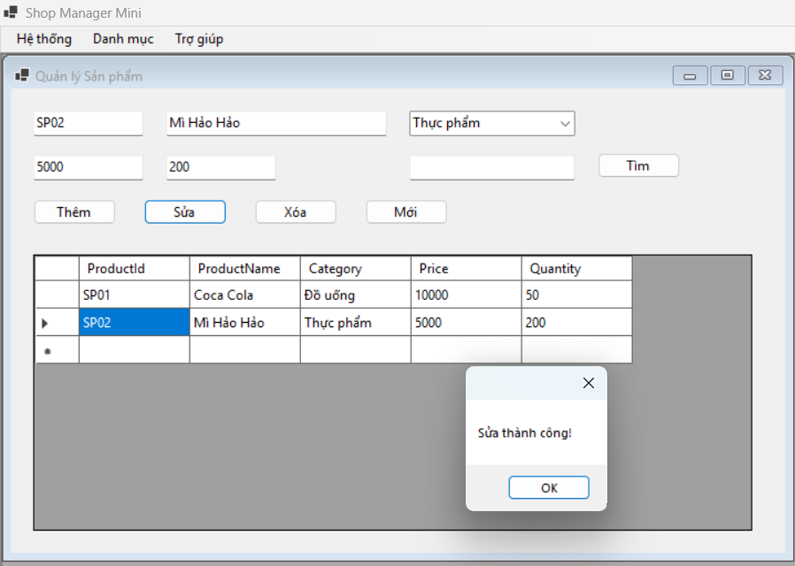
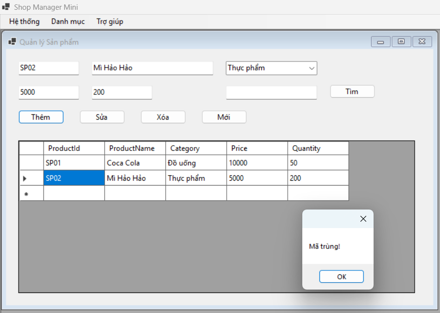
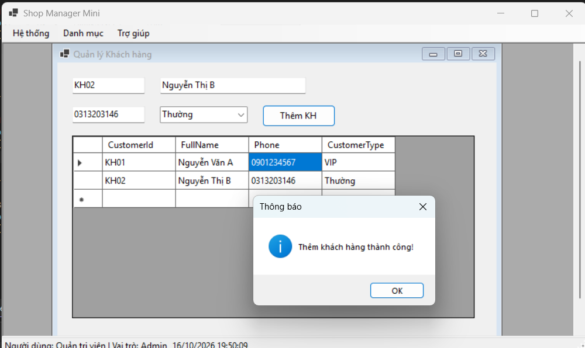
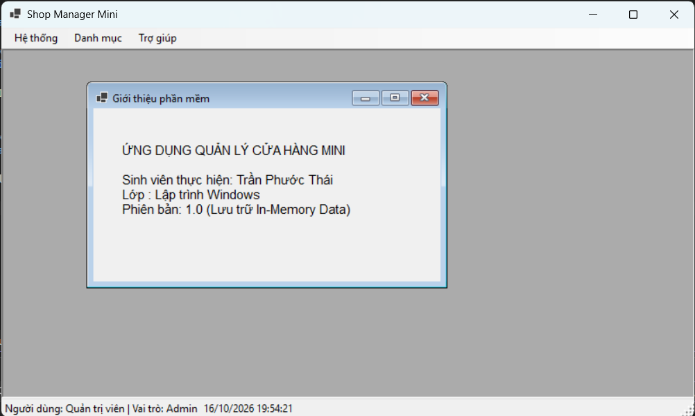
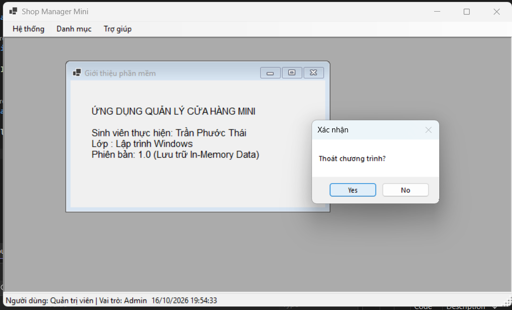

# BÁO CÁO THỰC HÀNH LAB 07
**Tên bài thực hành:** Xây dựng ứng dụng quản lý cửa hàng mini nhiều Form (ShopManagerMini)
**Học phần:** COMP1019 - Lập trình trên Windows

## 1. Thông tin sinh viên
2611COMP101904-Lap-trinh-Windows
MSSV: 51.01.104.091
Họ và tên: Trần Phước Thái
Lớp: CNTT.B
Nhóm: 9

## 2. Mục tiêu bài Lab
- Tạo ứng dụng WinForms gồm nhiều Form (MDI - Multiple Document Interface).
- Xây dựng chức năng đăng nhập và truyền thông tin người dùng sang Form chính.
- Tạo Form chính (MDI Parent) tích hợp MenuStrip và StatusStrip.
- Quản lý các Form con (MDI Child) qua menu, đảm bảo không mở trùng Form cùng loại.
- Thực hiện thao tác quản lý dữ liệu (Thêm, Sửa, Xóa, Tìm kiếm) trực tiếp trên bộ nhớ (In-memory Data) sử dụng `BindingList<T>`.

## 3. Công nghệ và Kiến trúc sử dụng
- **Ngôn ngữ & Nền tảng:** C# Windows Forms (.NET Framework).
- **Lưu trữ dữ liệu:** Lưu trữ tạm trên RAM (In-memory Data), không kết nối CSDL ngoài.
- **Cấu trúc thư mục:** Phân chia rõ ràng Model (`User`, `Product`, `Customer`) và Giao diện (`FrmLogin`, `FrmMain`, `FrmProduct`, `FrmCustomer`, `FrmAbout`).

## 4. Các chức năng đã hoàn thiện
- **Đăng nhập:** Kiểm tra tài khoản mẫu (`admin`/`123`, `user`/`123`), bắt lỗi bỏ trống thông tin, truyền đối tượng User sang Form Main.
- **Màn hình chính (MDI Parent):** Điều hướng giao diện qua MenuStrip, hiển thị thông tin tài khoản và thời gian thực dưới StatusStrip.
- **Quản lý Sản phẩm:** Hoàn thiện thao tác CRUD (Thêm, Sửa, Xóa, Tìm kiếm, Làm mới). Bẫy lỗi trùng mã sản phẩm, kiểm tra giá và số lượng hợp lệ.
- **Quản lý Khách hàng:** Thêm mới khách hàng, phân loại (VIP/Thường) và hiển thị lên danh sách.
- **Giới thiệu:** Màn hình About tĩnh hiển thị thông tin bài Lab.

## 5. Hình ảnh minh họa

### 1. Form Đăng nhập ban đầu

### 2. Cảnh báo khi nhập sai tài khoản hoặc mật khẩu

### 4. Form Quản lý Sản phẩm tải dữ liệu ban đầu

### 6. Khi sửa thông tin sản phẩm thành công

### 7. Cảnh báo lỗi khi thêm trùng Mã sản phẩm đã có

### 8. Form Quản lý Khách hàng và khi thêm thành công khách hàng

### 7. Màn hình Giới thiệu phần mềm (FrmAbout)

### 8. Hộp thoại xác nhận khi bấm Thoát chương trình
