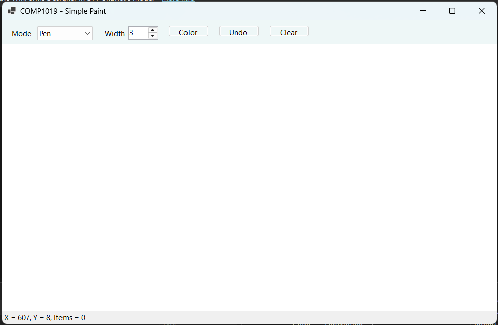
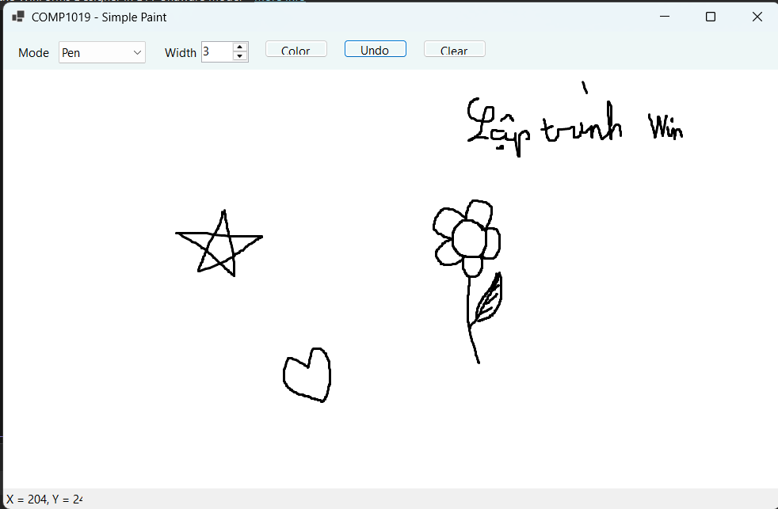
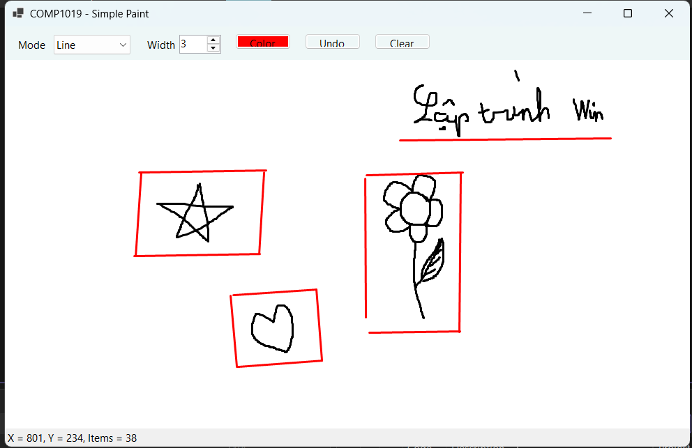
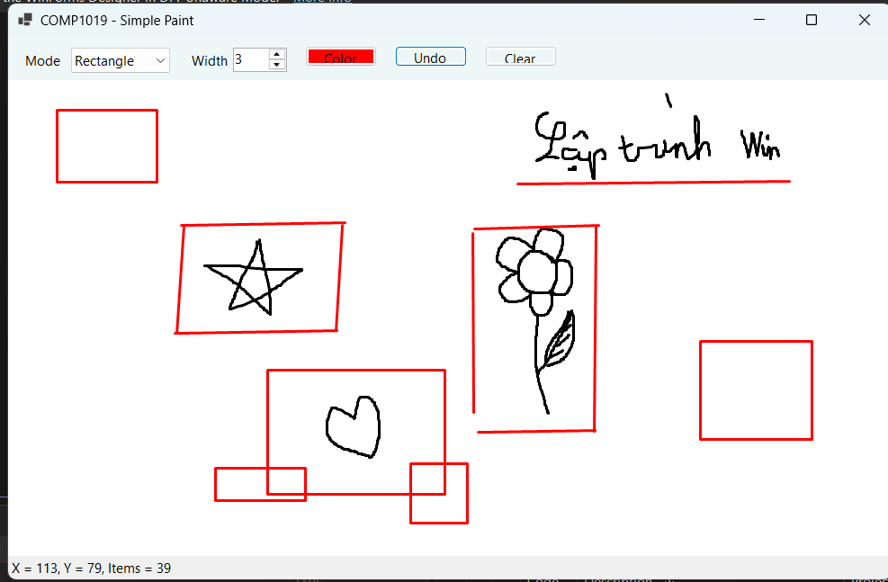
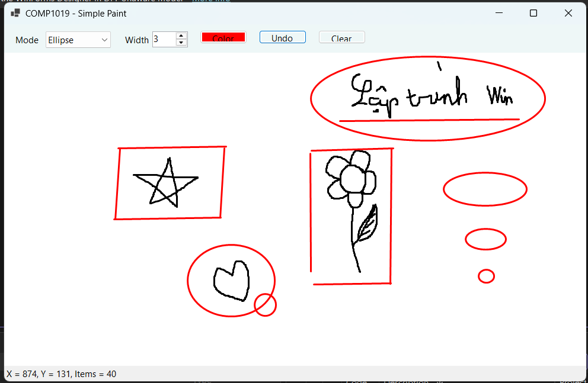
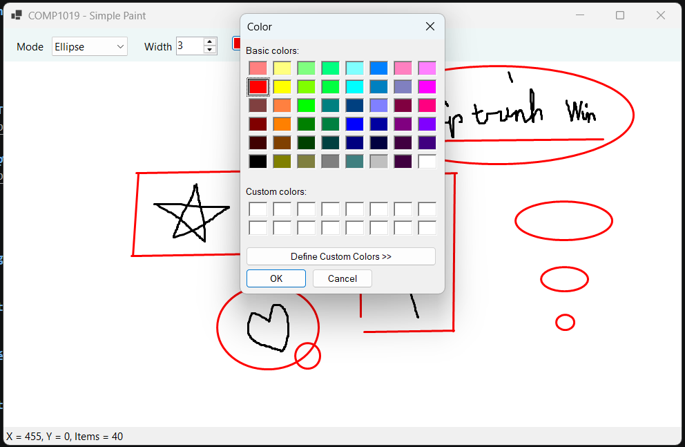
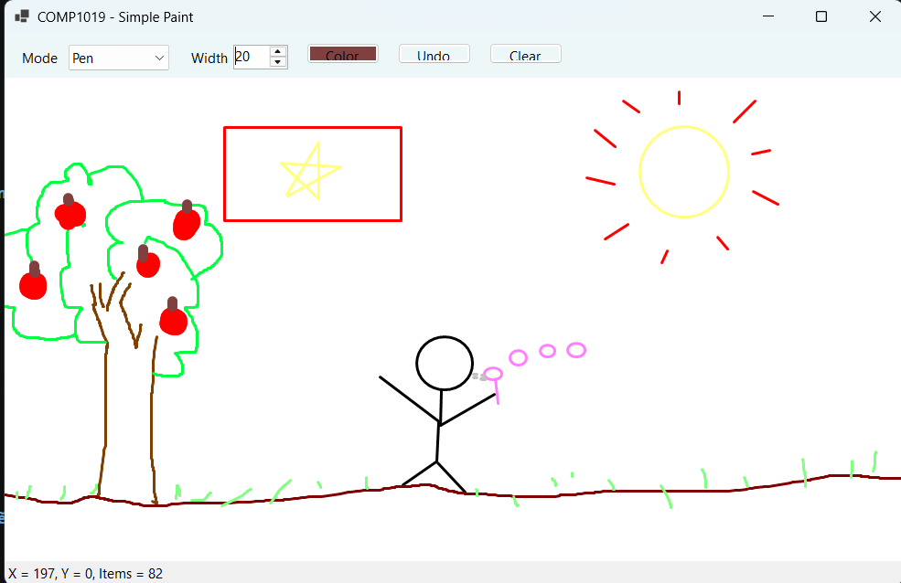
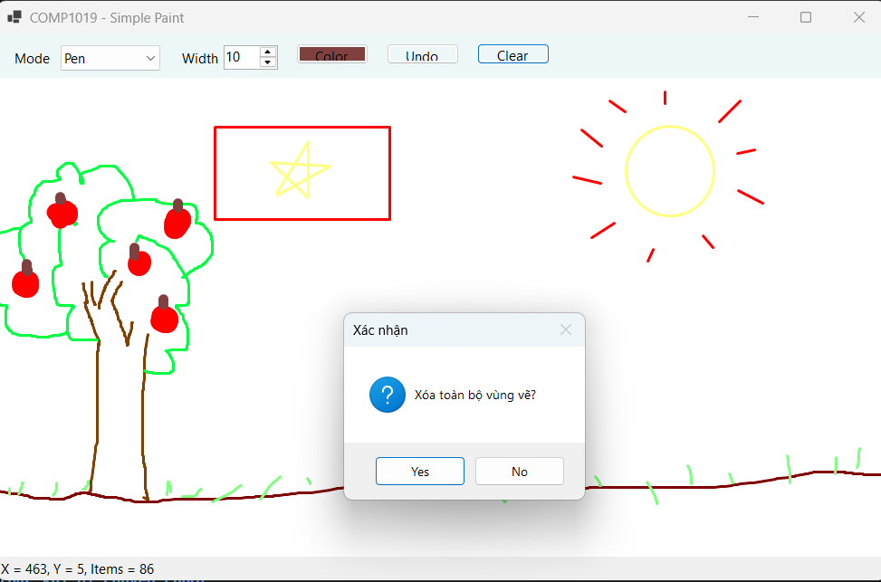
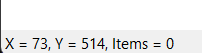

# BÁO CÁO THỰC HÀNH LAB 08
**Tên bài thực hành:** Xây dựng ứng dụng Paint đơn giản bằng WinForms và GDI+
**Học phần:** COMP1019 - Lập trình trên Windows

## 1. Thông tin sinh viên
- **Họ và tên:** Trần Phước Thái
- **Mã số sinh viên:** 51.01.104.091

## 2. Mục tiêu bài Lab
- Ứng dụng thư viện đồ họa GDI+ (`System.Drawing`).
- Nắm vững cách xử lý các sự kiện chuột: `MouseDown`, `MouseMove`, `MouseUp` để vẽ tương tác.
- Hiểu được cơ chế hoạt động của sự kiện `Paint` và hàm `Invalidate()` để lưu hình ảnh không bị mất khi Resize.
- Xử lý chống nhấp nháy màn hình bằng kỹ thuật `DoubleBuffered`.

## 3. Công nghệ và Kiến trúc sử dụng
- **Cấu trúc lưu trữ:** Dữ liệu từng nét vẽ (màu sắc, độ dày, tọa độ) được lưu vào danh sách `List<DrawItem>`.
- **Tối ưu UI:** Custom class `DrawSurface` kế thừa Panel để bật buffer kép.
- **Toán học:** Xử lý tọa độ âm khi kéo chuột ngược hướng bằng `Math.Min` và `Math.Abs`.

## 4. Hình ảnh minh họa

### 1. Giao diện tổng quan ban đầu

### 2. Vẽ tự do (Pen) với nhiều nét

### 3. Vẽ đường thẳng (Line)

### 4. Vẽ Hình chữ nhật (Kéo từ Trái sang Phải)

### 5. Vẽ Hình Elip

### 6. Thao tác chọn màu mới bằng ColorDialog

### 7. Vẽ hình với màu mới và nét siêu đậm (Width = 20)

### 8. Hộp thoại xác nhận thao tác Clear (Xóa toàn bộ vùng vẽ)

### 9. Thanh StatusStrip cập nhật tọa độ X, Y theo thời gian thực khi di chuyển chuột
