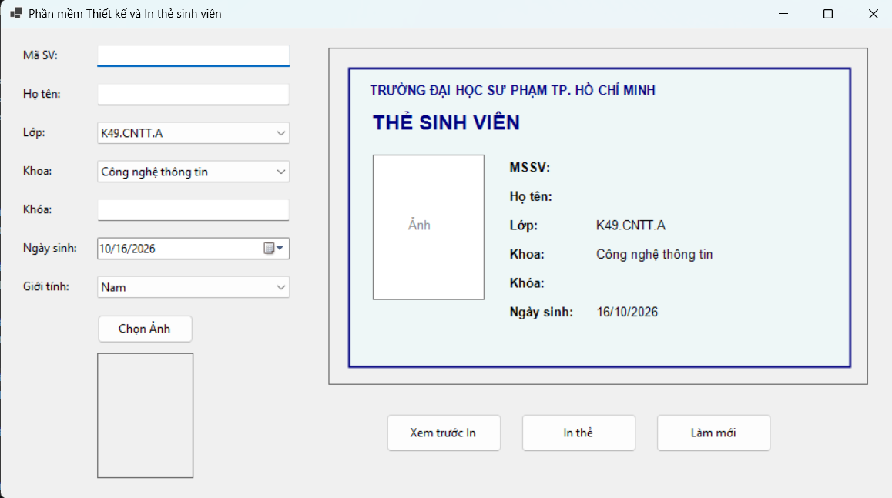
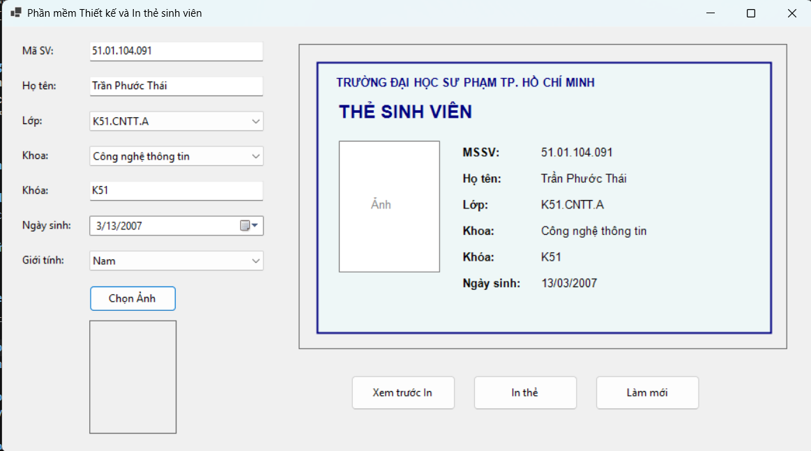
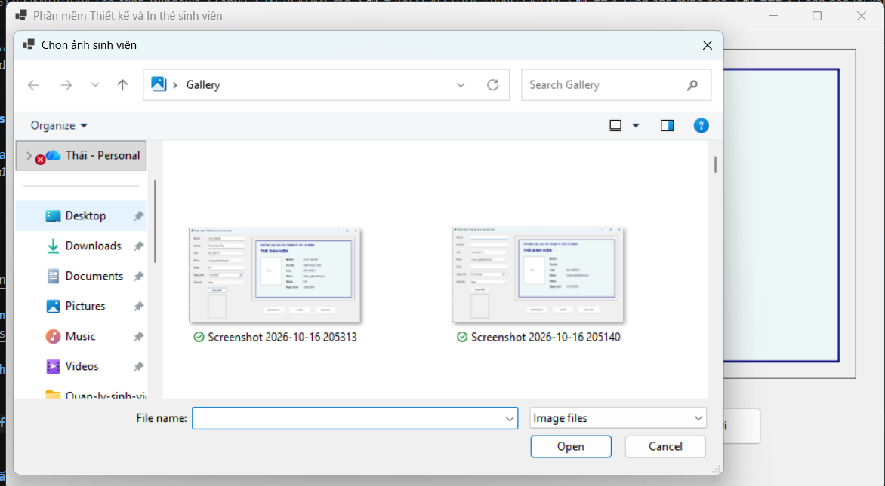
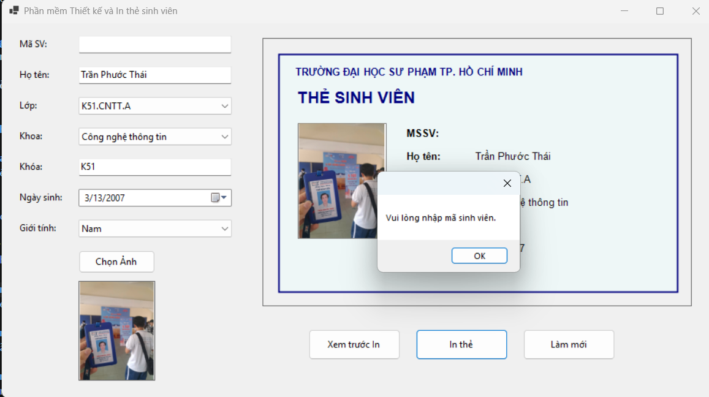
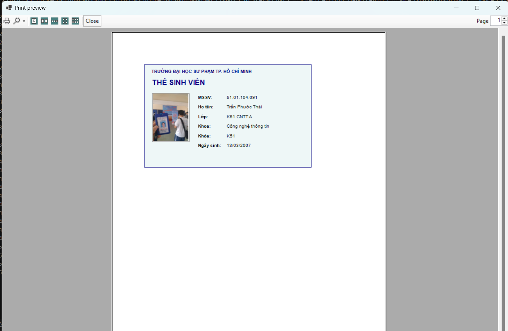
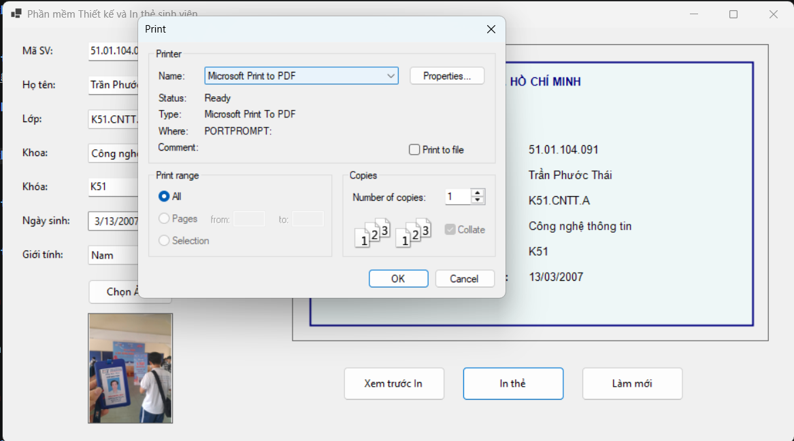
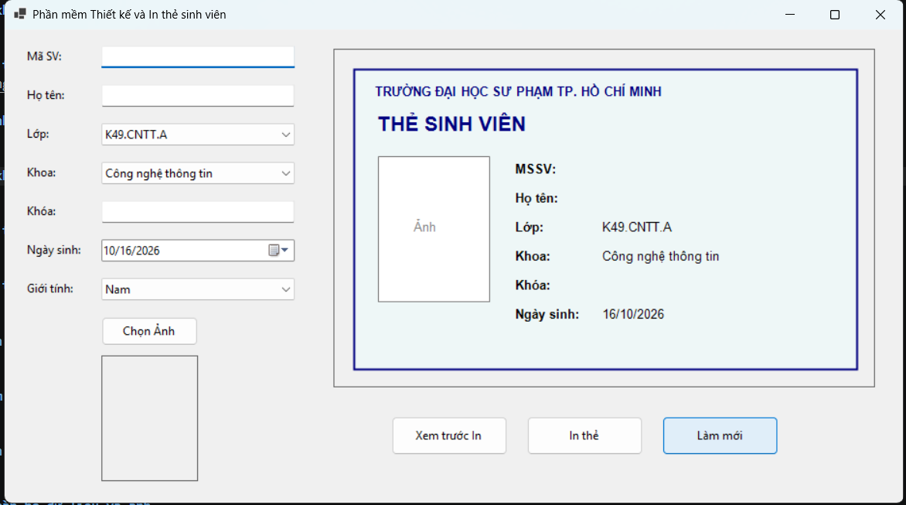

# BÁO CÁO THỰC HÀNH LAB 09
**Tên bài thực hành:** Thiết kế và in thẻ sinh viên bằng WinForms
**Học phần:** COMP1019 - Lập trình trên Windows

## 1. Thông tin sinh viên
- **Họ và tên:** Trần Phước Thái
- **Mã số sinh viên:** 51.01.104.091
- **Lớp:** [Nhập mã lớp]

## 2. Mục tiêu bài Lab
- Xử lý ảnh: Sử dụng `OpenFileDialog` và `PictureBox` để load ảnh chân dung, nhân bản Bitmap để tránh khóa file.
- GDI+ nâng cao: Tạo bản Preview động của thẻ trên Panel.
- In ấn: Sử dụng `PrintDocument` và `PrintPreviewDialog` để xuất thẻ ra trang giấy A4.
- Kiểm tra tính toàn vẹn của dữ liệu đầu vào (Validation) trước khi cho phép in.

## 3. Công nghệ và Kiến trúc sử dụng
- **Mô hình hóa dữ liệu:** Sử dụng lớp `StudentCardInfo` gói gọn dữ liệu, giúp dùng chung 1 hàm vẽ (`DrawStudentCard`) cho cả Panel Preview và PrintDocument.
- **Tương tác:** Gọi hàm `Invalidate()` mỗi khi có sự kiện `TextChanged` để bản xem trước cập nhật theo thời gian thực.
- **Bẫy lỗi:** Try-Catch khi đọc file ảnh để tránh crash nếu người dùng chọn file hỏng.

## 4. Hình ảnh minh họa

### 1. Giao diện mặc định lúc mới khởi chạy

### 2. Gõ chữ vào TextBox, bản xem trước thẻ tự động cập nhật chữ

### 3. Mở OpenFileDialog để chọn ảnh đại diện

### 4. Cảnh báo Validation: Bấm In thẻ nhưng để trống Mã sinh viên

### 5. Hộp thoại Print Preview (Xem trước bản in thực tế trên trang giấy)

### 6. Hộp thoại Print Dialog (Chọn máy in để xuất)

### 7. Bấm Làm Mới để xóa trắng toàn bộ dữ liệu và ảnh
