# BÁO CÁO THỰC HÀNH LAB 10
**Tên bài thực hành:** Thiết kế và cài đặt cơ sở dữ liệu EduManagerDB
**Học phần:** COMP1019 - Lập trình trên Windows

## 1. Thông tin sinh viên
- **Họ và tên:** Trần Phước Thái
- **Mã số sinh viên:** 51.01.104.091

## 2. Mục tiêu bài Lab
- Phân tích và thiết kế cơ sở dữ liệu quan hệ quản lý sinh viên.
- Viết mã T-SQL để khởi tạo DB, tạo bảng, thiết lập Primary Key, Foreign Key.
- Cài đặt các ràng buộc (CHECK constraints) để bảo vệ dữ liệu (Điểm, Tín chỉ, Giới tính).
- Thực hành thao tác CRUD cơ bản và các truy vấn nâng cao (JOIN, GROUP BY, HAVING).
- Chạy các script test case để chứng minh DB có khả năng chặn dữ liệu sai (Bẫy lỗi CSDL).

## 3. Công nghệ và Môi trường
- **Công cụ:** SQL Server Management Studio (SSMS).
- **Cấu trúc script:** Tách biệt 3 file `01_CreateDatabase.sql`, `02_InsertSampleData.sql` và `03_Queries.sql`.

## 4. Hình ảnh minh họa (Showcase Query & Test Case)

### 1. Khởi tạo thành công 6 Bảng (Xem trên Object Explorer)
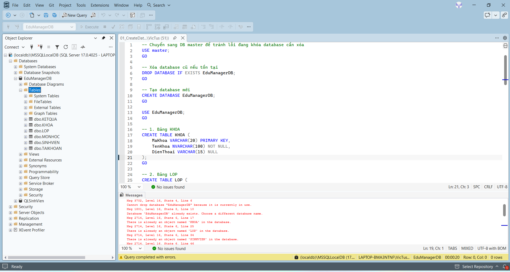

### 2. Nhập dữ liệu mẫu thành công cho tất cả các bảng
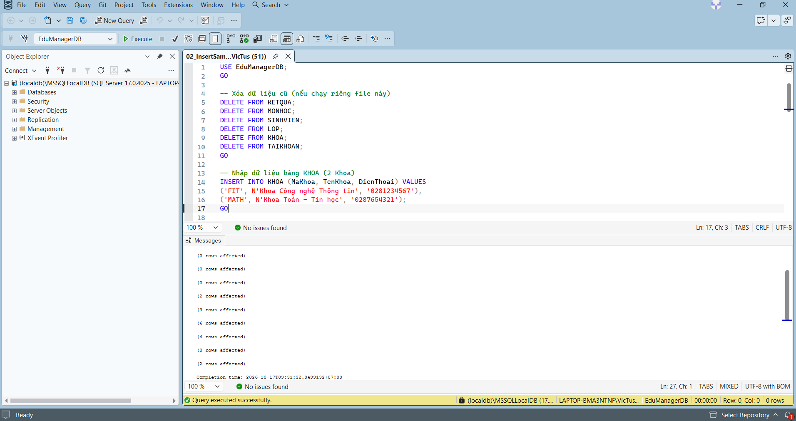

### 3. Liệt kê toàn bộ sinh viên (SELECT cơ bản)
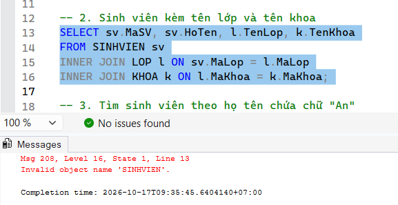

### 4. Truy vấn kết hợp Sinh viên - Lớp - Khoa (INNER JOIN)
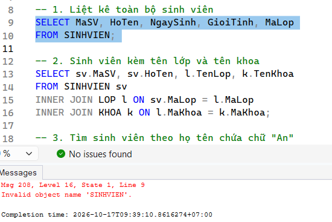

### 5. Tìm kiếm sinh viên theo một phần họ tên (LIKE)
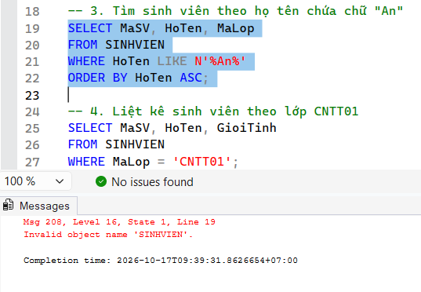

### 6. Cập nhật tên sinh viên thành công (UPDATE)
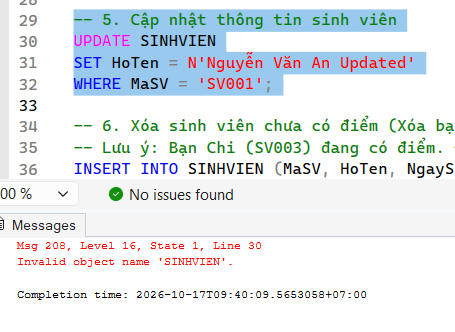

### 7. Tính điểm trung bình của từng sinh viên (GROUP BY + AVG)
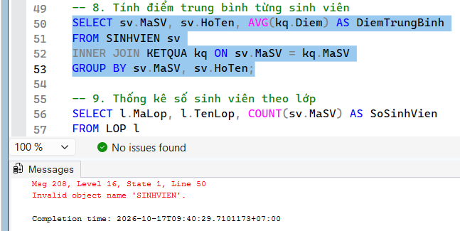

### 8. Thống kê sĩ số, chỉ lấy lớp có từ 2 sinh viên trở lên (GROUP BY + HAVING)
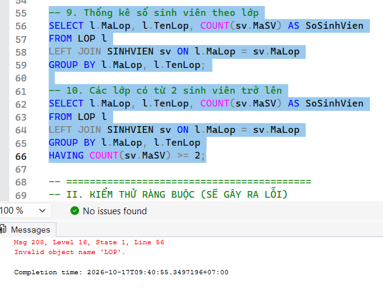

### 9. Test lỗi Ràng buộc: Thêm sinh viên vào Lớp không tồn tại (Lỗi Khóa ngoại FK)
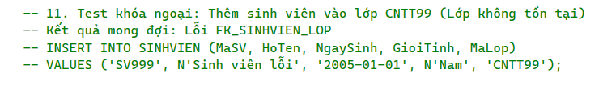

### 10. Test lỗi Ràng buộc: Nhập điểm > 10 (Lỗi CHECK Constraint Diem)
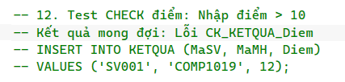

### 11. Test lỗi Ràng buộc: Nhập sai Giới tính (Lỗi CHECK Constraint GioiTinh)
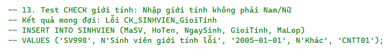

### 12. Test lỗi Ràng buộc: Nhập trùng Mã SV (Lỗi Khóa chính PK)
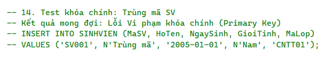